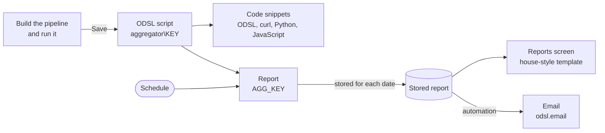

# How the Aggregator works

An aggregation reads the documents of one platform service, passes them through a pipeline of stages, and returns rows. The Aggregator runs the same pipeline the [REST API](/docs/api/rest/aggregation) and the ODSL [aggregate command](/docs/odsl/command/aggregate) accept, so anything you build in the portal can also run from a script, a report or your own code.



---

## Services and sources

The **Service** in the workspace toolbar is the data the aggregation reads. Services that hold more than one copy of their data also ask for a **Source**:

| Source | What it holds |
|-|-|
| `private` | Your organisation's own data |
| `public` | Data published by OpenDataDSL |
| `common` | Shared data, such as the deliveries of common datasets |
| `all` | Private and common together, where the service supports it |

Services such as automations, automation logs and Fusion AI usage have a single source, so the source is not asked for. **Another service...** at the end of the list lets you type the name of any other service.

Northgate Energy's aggregation reads **Dataset deliveries**, source `common`: one document per dataset per ondate, with its `dsid`, `status`, `score` and `timings`.

---

## Stages

A pipeline is a list of stages, run in order. Each stage is a card in the workspace:

| Part of the card | What it does |
|-|-|
| Operator | The stage, such as `$match` or `$group`, with a short summary of its value beside it |
| Value | The stage's value as JSON |
| **Run up to this stage** | Runs the pipeline as far as this stage, to see what it produces at that point |
| **Turn this stage off** | Leaves the stage out without deleting it |
| **Move up**, **Move down**, **Duplicate**, **Remove** | Rearrange the pipeline |
| Help line | What the stage does, with a link to its MongoDB documentation |

The six stages used most have their own buttons under the pipeline: `$match`, `$sort`, `$limit`, `$project`, `$group` and `$count`. These work on every service. **All stages** lists every MongoDB aggregation stage, in groups:

| Group | Stages |
|-|-|
| Filter and sort | `$match` `$sort` `$limit` `$skip` `$sample` `$redact` |
| Shape documents | `$project` `$addFields` `$set` `$unset` `$replaceRoot` `$replaceWith` |
| Group and summarise | `$group` `$count` `$sortByCount` `$bucket` `$bucketAuto` `$facet` |
| Arrays and nesting | `$unwind` |
| Time series and windows | `$densify` `$fill` `$setWindowFields` |
| Combine and join | `$lookup` `$graphLookup` `$unionWith` `$documents` `$geoNear` |
| Search (Atlas) | `$search` `$searchMeta` `$vectorSearch` `$rankFusion` `$scoreFusion` `$listSearchIndexes` |
| Diagnostics | `$collStats` `$indexStats` `$planCacheStats` `$currentOp` `$listSessions` `$listLocalSessions` `$listSampledQueries` `$shardedDataDistribution` `$querySettings` `$changeStream` `$changeStreamSplitLargeEvent` |
| Write | `$out` `$merge` (cannot be used) |

A new stage starts with an example value to change. A stage value is JSON, so field names and strings need double quotes: `{"status": "late"}`, not `{status: 'late'}`. A stage that is not valid JSON is outlined in red, with the position of the problem.

:::caution Where a stage can run
Some stages carry a note under them. Read it before you rely on the stage:

- **Joins** (`$lookup`, `$graphLookup`, `$unionWith`) read other collections by their database name, which is not always the service name, and only the service you chose is filtered to your data.
- **Atlas search** stages need MongoDB Atlas with a search index on the collection.
- **Diagnostics** are usually refused for application users.
- Some stages, such as `$geoNear`, `$documents` and the search and diagnostic stages, must be the **first** stage. On services the platform filters to your organisation (automations, Fusion AI usage and runs, users and others), and when your read policies restrict what you can see, the platform puts its own filter first, so these stages cannot run there.
- Newer stages need a recent MongoDB version, which the note gives.

Stages that write to the database (`$out`, `$merge`) and change streams cannot be used.
:::

---

## Date placeholders

Three placeholders can be used inside any string value of a stage:

| Placeholder | In the workspace | In a report |
|-|-|-|
| `@{ondate}` | The **Ondate** test date in the toolbar | The date the report runs for |
| `@{start}` | The **Start** test date | The start of the report's default range |
| `@{end}` | The **End** test date | The end of the report's default range |

Each is replaced with the date written as `yyyy-mm-dd`. Northgate Energy's `$match` uses `@{ondate}`, so the same aggregation lists the deliveries of whichever day it runs for:

```json
{"ondate": "@{ondate}"}
```

To keep the documents of a range, to the end of its last day:

```json
{"timestamp": {"$gte": "@{start}T00:00:00", "$lte": "@{end}T23:59:59"}}
```

---

## Report properties

Any other name in `@{...}`, such as `@{datasets}` or `@{hub}`, is a **report property**. When a report runs, the platform passes the report configuration to the aggregation as `#REPORT`, and each report property placeholder is filled from that report's properties. One aggregation can then serve several reports, each with its own values.

Northgate Energy's market data team wants a second report, for the ICE desk, that lists only the ICE datasets. Rather than copy the aggregation, they add a placeholder to its `$match`:

```json
{"ondate": "@{ondate}", "dsid": {"$regex": "@{datasets}"}}
```

As soon as a stage uses a report property, the workspace shows a **Report properties** card under the pipeline, with a test value for each one. They give `@{datasets}` the test value `.*`, which matches every dataset:


Each report then sets its own value: the ICE desk's report sets `datasets` to `^ICE_`, and the original report does not set it, so it keeps every dataset. See [One aggregation, several reports](/docs/extensions/aggregator/reports#one-aggregation-several-reports).

Where the value comes from:

| When the aggregation runs | The value used |
|-|-|
| In the workspace | The test value in the **Report properties** card |
| In a report that sets the property | The report's value |
| In a report that does not set it | The test value saved with the aggregation |
| From code or another script, without a report | The test value saved with the aggregation |

:::note Names and values
- A name starts with a letter and uses letters, digits and underscores. Names are case sensitive: `@{Hub}` and `@{hub}` are different properties.
- A name cannot be one of the report's own settings, such as `name`, `description`, `template` or `cron`. The exceptions are `currency`, `units` and `timezone`: these report settings are meant to be read this way, and the report editor sets them.
- A value is put into the stage as text, so it cannot contain double quotes, backslashes or line breaks. It is then read like any other value (see below): `"5"` becomes the number 5.
:::

---

## How values are read

The platform converts string values in a pipeline before it runs it:

| You write | It becomes |
|-|-|
| A string that looks like a date, such as `"2026-10-15"` or `"@{start}T00:00:00"` | A date, so it can be compared with a date field |
| `"10"` | The number 10 |
| `"true"`, `"false"` | true, false |
| `"string@2026-10-15"` | The string `2026-10-15`, not converted |
| The value of a field called `ondate` | Kept as it is, because ondates are stored as strings |

:::note
This is why `{"ondate": "@{ondate}"}` matches the deliveries of the day, while a field that holds a date as a string would need `"string@..."` to be compared with a string.
:::

---

## Results

**Run** (or Ctrl+Enter) runs the pipeline and shows the number of rows and columns, how long it took and the stages run. The rows are shown as a **Table**, sortable by any column, or as **JSON**, and **CSV** downloads them. Nested fields are shown as columns with dotted names, such as `_id.playbook`.

The preview stops at 1,000 rows when the pipeline has no `$limit` or `$count` of its own. A saved aggregation, a report and the code snippets are not limited.

---

## What is saved

**Save** stores the aggregation as a private ODSL script, `aggregator\KEY`, in the category `aggregation`, with its description. The script has one function, `aggregate_KEY`, in two forms. Both return the rows:

| Function | Used by | Report properties |
|-|-|-|
| `aggregate_KEY(ondate, start, end, report)` | Reports, which call it as `aggregate_KEY(#ONDATE, #START, #END, #REPORT)` | Read from the report, with the test values for any it does not set |
| `aggregate_KEY(ondate, start, end)` | Scripts, processes and reports made before report properties | The test values |

```js
import ${script:"aggregator\dataset_deliveries"}

rows = aggregate_dataset_deliveries(Date("2026-10-15"), Date("2026-10-01"), Date("2026-10-15"))
```

Because it is an ordinary ODSL function, anything that runs ODSL can call it: a report, a process, another script, or another user with access to your private scripts. The script's first lines hold the definition the Aggregator reads back, so open it in the Aggregator to change it.

:::caution
Changes made to the script by hand are replaced the next time the aggregation is saved.
:::

---

## When to use it, and when not to

Use the Aggregator for summaries and checks you want to repeat: counts, totals, latest values, lists of exceptions. Put a `$match` first, so the database reads only the documents you need.

It is not the tool for editing data (stages that write cannot be used), for browsing every document of a service (use that service's own screen), or for joining data across services you are not sure are filtered to your organisation (see the caution above).

---

## Next

[Building an aggregation](/docs/extensions/aggregator/building): build Northgate Energy's dataset deliveries aggregation step by step.
