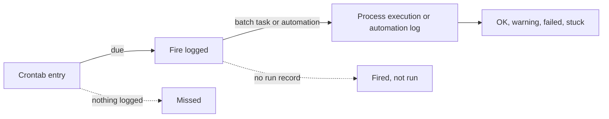

# Cron Schedule Diagnostics

When a scheduled automation or process does not run, or runs at the wrong time, the cause can be in three places: the schedule itself, the scheduler that fires it, or the run it starts. **Cron Schedule Diagnostics** joins all three for every schedule in your tenant, so you can see straight away which step went wrong. It answers questions like:

- Did everything that was due in the last 24 hours actually fire, and did it run?
- Was the scheduler down at some point, or is only one schedule affected?
- Did a run start but fail, or was it fired and never started at all?
- Is a schedule still firing for an automation or process that was disabled or deleted?
- Does the schedule the scheduler uses match the cron saved on the automation or process?
- When exactly will this cron expression fire, in UTC and in UK or European time?

At Northgate Energy, Priya Shah opens it when the morning curve email has not arrived or a loader's data is missing, to find out in a minute whether the run failed, was never fired, or is waiting for a batch node.

---

## How a scheduled run works

Every scheduled run leaves three records behind, and the report reads all three:

| Step | Record | What it holds |
|-|-|-|
| 1. Schedule | **Crontab entry** (`crontab` service) | One entry per [scheduled automation](/docs/extensions/automations/creating#scheduled-automations), scheduled process, report, playbook task or agent, written when you save it with a cron. The cron is stored as its separate parts (minute, hour, day of month, month, day of week, year and timezone). A scheduled automation's entry is called `automation:` followed by the automation id. |
| 2. Fire | **Crontab log** (`crontablog` service) | One record each time the scheduler fires an entry: the scheduled minute, when it was logged, and a fire id |
| 3. Run | **Process execution** (`process-exec` service), or for a scheduled automation its **automation log** entry | The run itself: status, start, end, message and the job it ran on. A process execution's id is the same as the fire id; an automation log entry keeps the fire id as its root invocation id. |

The report works out from each crontab entry when it **should** have fired in the range, using the same rules as the scheduler, and compares that with what was logged and what ran.

---

## Opening the report

The report is one of the Automations extension's [insight reports](/docs/extensions/automations/monitoring#insight-reports), in the **Automations** category of **Insights**, as **Cron Schedule Diagnostics** (report id `odsl.automations.cron_diagnostics`). It shows the schedules of the tenant and environment you are working in.

It opens on the **Overview** tab with **All schedules** for the **Last 24 hours**. When it is opened with a crontab entry name (such as a process name) passed to the report as `SCHEDULE`, that schedule is chosen in the **Schedule** filter. To change schedules rather than diagnose them, use the [Schedules](/docs/extensions/automations/schedules) tab of the Automations screen.

All times are UTC. For schedules in the `EU1` or `EU2` timezone, the local time is shown next to the UTC time.

| Control | What it does |
|-|-|
| **Date range** | **Last hour**, **Last 6 hours**, **Last 24 hours**, **Today**, **Yesterday**, **Last 3 days**, **Last 7 days** or **Last 14 days**. Fills in **Start** and **End** and reloads every tab. |
| **Start**, **End** | Your own range, up to 31 days |
| **Schedule** | **All schedules**, or one. Choosing one opens its **Timeline**. |
| **Type** | Only schedules of one type: **Process**, **Report**, **Alert**, **Export curves**, **Automation**, **Agent**, **Playbook** or **Curve** |
| **Refresh** | Loads everything again |
| **Clear filters** | Resets **Schedule** and **Type** |
| **Debug log** | At the bottom of the page: the requests made and how many items came back |

:::tip
Almost every schedule name in the report is a link. Click it to open that schedule's **Timeline**.
:::

---

## Key ideas

| Idea | What it means |
|-|-|
| **Expected fire** | A minute in the range when the crontab entry is due. Only minutes after the entry was created, and more than two minutes ago, are counted. |
| **Fired** | The scheduler logged the fire |
| **Missed** | An expected fire that the scheduler never logged |
| **Fired, not run** | The scheduler logged the fire but no run record (process execution or automation log entry) arrived within five minutes |
| **Stuck in triggered** | The batch task was created but has not started after 15 minutes |
| **Fire delay** | How long after the scheduled minute the fire was logged. More than two minutes is flagged as **late**. |
| **Start lag** | How long after the fire the run started: for processes, the time spent waiting for a batch node. More than 10 minutes is flagged as **slow to start**. |
| **Scheduler outage** | A stretch of time when schedules were due but the scheduler logged nothing at all, for any schedule |

---

## The tabs

### Overview

| Card | What it shows |
|-|-|
| **Schedules** | Crontab entries for this tenant and environment |
| **Fired / expected** | Fires logged, against fires that were due |
| **Ran OK** | Fires whose run succeeded (and how many finished with warnings) |
| **Failed** | Fires whose run failed |
| **Missed fires** | Expected fires that were never logged |
| **Fired, not run** | Fires with no run record |
| **Late or stuck** | Late fires, and runs stuck waiting to start |
| **Config issues** | Problems with the schedules themselves, listed on the **Diagnose** tab |

**Scheduled Fires** is a stacked column chart of fires per hour (for ranges up to 3 days) or per day, coloured by outcome. Missed and not run fires are hatched red, so a gap in the scheduler stands out from runs that failed. Hover over a column for its counts.

Below it, four small tables: **Top Issues**, **Scheduler Outages**, **Most Missed or Not Run** and **Coming Up** (the next schedules due).

### Diagnose

This is the place to start when something did not run. The number on the tab is the number of issues found; it turns red when any of them is a problem.

**Scheduler Outages** lists the periods when nothing at all was logged while schedules were due, with the silent window (from just after the last fire logged before it to just before the next one), the fires that were due in it and the schedules affected. If every schedule misses the same minutes, the scheduler itself was not running; one schedule missing fires on its own is a problem with that schedule.

**Issues** lists everything found, worst first, with how often it happened, when it was first and last seen, and what to check. Click a row to open the schedule's **Timeline**.

The issues the report looks for:

| Issue | Severity | What it means and what to do |
|-|-|-|
| **Missed fire** | Problem | Other schedules fired at that minute but this one was not logged. Check the entry in the **Cron Tester**, and whether it was changed during the range. |
| **Missed (scheduler outage)** | Problem | Nothing at all was logged at that minute. The scheduler was not running. |
| **Fired, no run** | Problem | The fire was logged but no run arrived. For a process, the batch task was probably not created (for example the job is missing or disabled), or the process execution message was lost. For an automation, the platform did not pick up the run message. Search the scheduler's and the platform's logs for the fire id. |
| **Scheduled run failed** | Problem | The run started and failed. The latest message is shown. |
| **Day of week never matches** | Problem | The day of week is a number, such as `1-5`. The platform accepts it, but the scheduler only matches day names (`MON` to `SUN`), `*`, `?`, `L` and `n#w`, so the schedule never fires. Use day names. |
| **Never fires** | Problem | The schedule has no fire time in the next 400 days |
| **Not scheduled** | Problem | An enabled scheduled automation, process or report has a cron but no crontab entry, so it never runs on schedule. Save it again to recreate the entry. |
| **Process and report share a name** | Problem | The crontab holds one entry per name, so a process and a report with the same name and both with a cron overwrite each other's schedule. Rename one. |
| **Duplicate crontab entries** | Problem | More than one entry with the same name, so every fire runs the work more than once |
| **Unknown timezone** | Problem | The entry's timezone is not `UTC`, `EU1` or `EU2`, so it never fires |
| **Entry differs from definition** | Check | The cron saved on the process or report is not the one in the crontab entry, so the scheduler is still using the old schedule. Save the process or report again. |
| **Orphan entry** | Check | There is no automation, process, report or playbook task with this name any more, but the entry is still fired. An orphan automation entry is removed by the platform the next time it fires. |
| **Disabled but scheduled** | Check | The automation, process or report is disabled but its entry is still there, so it is still fired. Save it again to remove the entry. |
| **Definition has no cron** | Check | The cron was removed but the entry is still there |
| **Type not run by odsl-cron** | Check | The scheduler logs fires of this type (such as `playbook`, scheduled Fusion AI playbook tasks) but has no handler to start them |
| **Stuck in triggered** | Check | The batch task was created but never started. Check the job exists and is enabled, and that its pool has nodes or can scale up. |
| **Fired late** | Check | The fire was logged more than two minutes late, because the scheduler was catching up after being past due |
| **Slow to start** | Check | The run started more than 10 minutes after it was fired, because the batch pool was busy or scaling up |
| **Fired more than once** | Check | The same minute was logged more than once, for example by two schedulers running at the same time |
| **Fired off schedule** | Note | A fire at a time the current entry does not match, usually because the schedule was changed during the range |
| **n#w day of week**, **Day of month and day of week** | Note | Reminders of how the scheduler reads these: it counts `n#w` days from 0 = Monday and weeks as days 1 to 7, 8 to 14 and so on, and a restricted day of month and day of week must **both** match |

### Schedules

Every crontab entry, with its cron, whether it matches its automation, process or report, the next time it will fire, and what happened to its fires in the range: expected, fired, OK, failed, missed and not run, a health bar, and the last fire and its outcome. Schedules with problems come first. A scheduled automation shows its sentence under its entry name. Enabled automations, processes and reports with no entry are listed as **no crontab entry**, and schedules that fired in the range but no longer have an entry as **crontab entry removed**. Click a row to open its **Timeline**.

At Northgate, the Schedules tab showed that `EEX_CURVES` still runs every 15 minutes although the process was changed to every 30: the entry had not been rewritten. It also showed that the positions automation to the ETRM queue was fired at 12:00 but did not run.

### Timeline

Every expected and logged fire of one schedule, newest first. The summary at the top shows the crontab entry, its timezone, when it was created, its next three fires and how it compares with its definition, followed by a box for every issue found for it.

| Column | What it shows |
|-|-|
| **Scheduled for** | The minute the fire was due, in UTC |
| **Local time** | The same minute in UK or European time, for `EU1` and `EU2` schedules |
| **Outcome** | **Ran OK**, **Ran with warnings**, **Run failed**, **Running**, **Stuck in triggered**, **Fired, not run**, **Missed**, **Fired off schedule**, or **Fired (no run record)** for types that keep no run record, such as agents. A small **x2** shows a minute that was fired twice. |
| **Fired at**, **Fire delay** | When the fire was logged, and how late |
| **Run status**, **Run start**, **Start lag**, **Duration** | The run the fire started |
| **Job**, **Message** | Where it ran and its final message |

Tick **Problems only** to hide the fires that ran normally. Up to 1,000 fires are shown.

Click a fire to see its detail below the table: what the outcome means and what to check next, the fire record (fire id, the scheduler that logged it, the invocation id and the crontab entry id) and the run. For a process that is its status, message, times, start lag, job, batch account, failure details and phases; for an automation, its automation log entry: status, message, target, item, ondate and log entry id.

:::tip
For a fire that was logged but not run, the fire id and invocation id are what to search for in the scheduler's logs.
:::

### Fire Log

The scheduler's log of fires, newest first, 50 to a page, with the run each fire started. Use it to see exactly what the scheduler did, minute by minute. Click a row to open the fire on the **Timeline** tab. **Export (CSV)** downloads every fire that matches the filters.

### Cron Tester

Type a cron expression and select **Test** to check it the way the platform does when you save a process, and to see when it will fire. Select **Use selected schedule** to load the crontab entry of the schedule chosen in the **Schedule** filter.

The tester shows whether the platform accepts the expression (and if not, the platform's error), any warnings about parts that will not behave as intended, how the entry is stored, and the next 10, 25 or 100 fire times in UTC and local time, with the gap between them.

Things the tester catches that are easy to get wrong:

| Expression | Result |
|-|-|
| `*/15 * * * * *` | Rejected: write increments as start and step, `0/15 * * * * *` |
| `0 8 * * 1-5 *` | Accepted, but never fires: use `0 8 * * MON-FRI *` |
| `0 8 * * MON-FRI` | Rejected: the year part is required, `0 8 * * MON-FRI *` |
| `30 1 * * * * EU1` | On the October clock change night, 01:30 UK time happens twice; the scheduler fires it once |

See [CRON expressions](/docs/kb/cron) for the full syntax.

---

## Troubleshooting

| Problem | What to do |
|-|-|
| A warning says only the latest fires or runs were loaded | The range holds more than 20,000 fires or scheduled runs. Choose a shorter range; until then, older fires can show as missed or not run. |
| A schedule shows missed fires before it was changed | The report works out expected fires from the entry as it is now. Fires before a change are compared with the new schedule, and show as missed or off schedule. |
| **could not read** definitions | The report could not read the process, report or playbook task list, so it does not check the entries against them. Check your access rights. |
| A report held on an object shows **not checked** | Reports held on master data objects are not compared with their definition |
| Nothing is listed, or the Schedules tab says there are no crontab entries | Reading the schedules needs the `AutomationsCrontab` and `AutomationsCrontabLog` policies the extension installs; check you are a member |

---

## Related

- [Creating an automation](/docs/extensions/automations/creating#scheduled-automations): scheduled automations
- [Monitoring automations](/docs/extensions/automations/monitoring)
- [Process Execution Insights](/docs/public/insights/process-executions): every run, with failures, durations and stuck runs
- [Process Cron Audit Report](/docs/public/insights/process-cron-audit): who changed a process schedule
- [Execution History](/docs/public/insights/process-execution-history): the runs of one process in a simple table
- [CRON expressions](/docs/kb/cron): how to write a schedule
- [Insights](/docs/odsl/insights/general): how insight reports work
