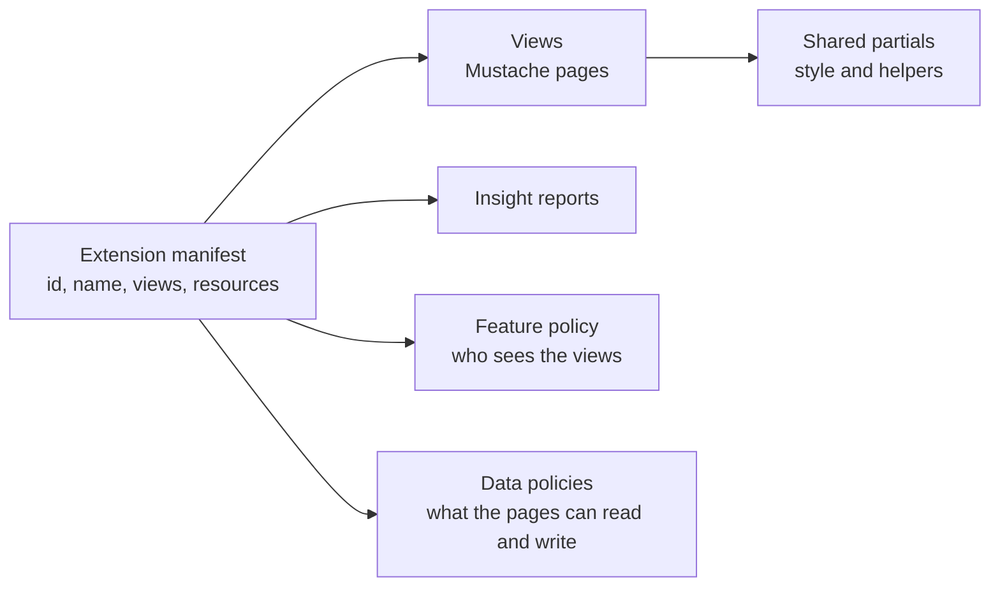
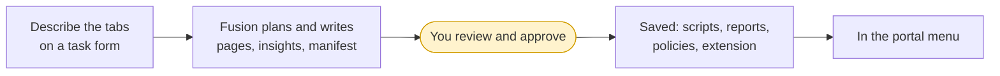

# How extensions work

An **extension** adds your own screens to the OpenDataDSL portal and Excel add-in: a menu item with tabs that show your data the way your team works with it, with insight reports alongside. The extensions in this section of the documentation, such as [Fusion AI](/docs/extensions/fusion-ai/overview), [Composer](/docs/extensions/composer/overview) and [Validation](/docs/extensions/validation/overview), are built in exactly the same way as the ones you build yourself.

---

## What an extension is made of

| Part | What it is |
|-|-|
| **Manifest** | The extension itself: its id, name, icon and description, its views, and the resources it needs. See [The extension manifest](/docs/extensions/building/manifest). |
| **Views** | The pages users open. Each view is a Mustache script of HTML, CSS and JavaScript that reads and writes platform data. See [Writing pages](/docs/extensions/building/pages). |
| **Shared partials** | Scripts the views include, typically the extension's own styles and JavaScript helpers |
| **Insights** | Report pages listed on the view's **Insights** tab. See [Insights and policies](/docs/extensions/building/insights-and-policies). |
| **Feature policy** | Decides which users see the extension's views |
| **Data policies** | Give users access to the data the pages read and write, when existing policies do not |

The manifest lists every script, insight report and policy the extension uses as its **resources**, so they are installed together.

---

## Where an extension appears

Each view says where it goes in the portal menu:

| Property | Meaning |
|-|-|
| **section** | The section of the left-hand menu, for example **Extensions**, **Information** or **Manage** |
| **name** | The menu item in that section. Views with the same name are tabs of one menu item. |
| **tabname** | The tab within the menu item. A tab called **Apps** collects views as apps, each with its own **appname**. |
| **insights** | Adds an **Insights** tab listing the extension's insight reports |
| **excel** | Shows the view in the Excel add-in instead |

For example, the Fusion AI extension puts seven views, all named **Fusion AI**, in the **Information** section, so they appear as the tabs Studio, Agents, Assistants, Tools, Playbooks, Tasks and Architecture.

---

## Private and public extensions

| | Where it lives | Who can use it |
|-|-|-|
| **Private** | Your tenant | The people your feature policy includes. An extension you create is private. |
| **Public** | The public extension catalogue | Any OpenDataDSL tenant that installs it. Publishing needs a publisher code from OpenDataDSL. |

An extension's id is its **publisher** and **code** joined with a dot, for example `acme.positions`. Use your company's publisher code even for private extensions, so the id is ready if you publish it later. See [Saving, installing and publishing](/docs/extensions/building/publishing).

---

## Three ways to build an extension

| Way | Best when |
|-|-|
| **With a Fusion AI playbook** | You can describe the tabs you want. Fusion plans the extension, writes every page, insight and the manifest, and saves it after you approve. See [Build an extension with Fusion AI](/docs/extensions/building/fusion-ai). |
| **With Fusion AI in a chat** | You want to change one page of an existing extension, or add a tab. Fusion has the same tools and reference material as the playbook. |
| **By hand** | You want full control, or you keep extensions in source control. Write the pages in VS Code with the OpenDataDSL extension, and create the extension with a `create-extension.odsl` script. |

The playbook is the quickest way to a working extension, and a good way to learn: every file it writes is shown to you before it is saved, and it also hands back the equivalent `create-extension.odsl` script for your source control.

---

## Next steps

- [Build an extension with Fusion AI](/docs/extensions/building/fusion-ai): the fastest way to a working extension
- [The extension manifest](/docs/extensions/building/manifest): the manifest, views and resources in detail
- [Writing pages](/docs/extensions/building/pages): page anatomy, the data API and the house style
- [Example extension](/docs/odsl/extension/odsl.example): an extension built from the platform's HTML components
