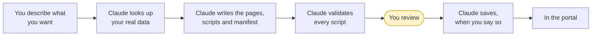

# Build with Claude

The **OpenDataDSL plugin for Claude** lets you build on the platform from Claude: in the Claude apps (web, desktop and mobile), in Claude Cowork and in Claude Code. Describe the insight, extension or script you want, and Claude writes it in the house style, checks it against your real data, and saves it to your tenant when you say so.

The plugin brings two things to Claude:

- **Knowledge of the platform**: skills that teach Claude the ODSL language, the house style for pages, the data API, the extension manifest, policies and publishing, with the reference documentation built in.
- **A connection to your tenant**: the [Fusion AI MCP server](/docs/product/mcp/overview), so Claude can look up your data, curves, types, scripts and processes, validate scripts and save them, always signed in as you.

---

## What the plugin adds

| Part | What it does |
|-|-|
| **ODSL scripting skill** | Writes, explains, fixes and reviews ODSL scripts: functions, processes, transformers, workflows, automations, and reading or saving timeseries, curves, events and master data |
| **Insights and extensions skill** | Builds insight reports (general, item and Excel insights) and extensions: the pages, the shared style and helper partials, the insight registrations, the feature and data policies, and the `create-extension.odsl` script |
| **Fusion AI connector** | Gives Claude the [Fusion AI tools](/docs/product/mcp/tools): finding data, curves, timeseries, types, scripts, processes and automations, validating and saving scripts, creating reports and processes |

Claude uses the skills by itself whenever a request is about OpenDataDSL: you do not need to name them.

---

## Claude or Fusion AI?

Both build the same extensions in the same house style. Choose by where you work.

| | Fusion AI in the portal | The plugin in Claude |
|-|-|-|
| **Where** | Inside the OpenDataDSL portal | The Claude apps, Claude Cowork, Claude Code |
| **How you ask** | The **Build an extension** playbook form, or a chat in the Studio | A conversation, with your own files, documents and screenshots alongside |
| **Approval** | A review step in the playbook run before anything is saved | Claude shows you every file and asks before it saves anything |
| **Files** | Saved to the platform | Saved to the platform, and with Cowork or Claude Code also written to your own folders or repository |
| **Best for** | A complete extension from a form, run in the background | Iterating on pages, working from a specification or existing code, keeping extensions in source control |

You can mix them: build an extension with the [playbook](/docs/extensions/building/fusion-ai), then refine a page with Claude, or the other way round.

---

## Installing the plugin

### In Claude and Claude Cowork

1. Open Claude (web or desktop) and select **Customize** in the left sidebar.
2. Open the **Plugins** tab, then **Discover**.
3. Find **OpenDataDSL** and select **Add**.

Plugins you add are saved to your Claude account, so the plugin is also available in Claude Code when you sign in there with the same account.

### In Claude Code

Run `/plugin` in a Claude Code session, find **OpenDataDSL** on the **Discover** tab, and install it.

### For your whole organisation

On Claude Team and Enterprise plans, an organisation owner can make the plugin available to everyone, or install it for them, from Organization settings. The plugin's source is the public repository [OpenDataDSL/odsl-claude-plugin](https://github.com/OpenDataDSL/odsl-claude-plugin), which can also be added as a plugin marketplace:

```
/plugin marketplace add OpenDataDSL/odsl-claude-plugin
/plugin install opendatadsl@opendatadsl
```

:::note
The Claude apps, Cowork and Claude Code show plugins slightly differently and change their menus from time to time. If a step above does not match what you see, see Anthropic's guide to [using plugins in Claude](https://support.claude.com/en/articles/13837440-use-plugins-in-claude).
:::

---

## Signing in to your tenant

The first time Claude needs your data, it asks Fusion AI to start a sign-in and shows you a code and a link. Open the link, enter the code and sign in with your normal Microsoft/Entra account, then tell Claude you are done. Your organisation's single sign-on, multi-factor authentication and conditional access all apply.

From then on, every request Claude makes runs as **you**: the same tenant, the same permissions and the same policies as when you use the portal. Claude never sees your password, and you never paste a key or token into the chat. See [Signing in](/docs/product/mcp/signing-in) for the details.

If the session expires, Claude asks you to sign in again.

---

## How a build works



1. **You describe it**: what the insight or extension is for, who uses it, the tabs, the filters, and the data if you know it.
2. **Claude looks at your data**: it finds the services, objects, curves or timeseries you mean, and reads real records so the filters and columns use field names that exist. It tells you when it had to assume something.
3. **Claude writes it** in the house style: header and filters, KPI cards and the pager at the top, tabs, server-side paging, sorting and aggregation, and every value escaped.
4. **Claude checks it** with the platform's own script validation, and fixes anything it reports.
5. **You review** the files. Ask for changes in plain language until it is right.
6. **Claude saves it** only when you ask: the feature policy and any data policies with `create_policy`, the pages with `save_script`, insight reports with `create_report`, and the extension itself with `create_extension`. It also gives you the equivalent `create-extension.odsl` script for your source control.

---

## Example: an item insight

> **You:** I'd like an insight on the Curves screen showing, for the selected curve, how many tenors changed each day over the last 30 days, with the biggest moves on a second tab.
>
> **Claude:** Let me sign you in to OpenDataDSL first. Open the link below and enter the code ... Thanks, you're signed in. I've looked at `ICE.NDEX.NLB:SETTLE` as a sample curve to check its fields. Here is the plan: an item insight in the **Curve Management Insights** category, so it appears on the Insights menu when a curve is selected. It reads the curve id and ondate the screen passes in, with an Overview tab (KPIs and a daily change count) and a Biggest moves tab. Here is the page and its registration. I validated the page and it has no errors. Shall I save it as `insight-curve-daily-changes` and create the report?
>
> **You:** Yes, save it.

The insight then appears on the **Insights** menu of the **Curves** screen when a curve is selected.

---

## Example: an extension

> **You:** Build an extension for our trading desk called Positions, publisher `acme`. Tabs: Positions, a paged list of POSITION objects by book and period with totals at the top; Limits, each book against its limit, closest to the limit first. Add a Position history insight. Only the Trading desk group should see it.
>
> **Claude:** I've checked the POSITION type: it has book, period, volume, price and mtm. The extension will be `acme.positions` in the **Extensions** section, with a style and a helpers partial, two views and one insight, visible to the Trading desk group. Here are the five pages, the insight registration and the manifest. I validated every page. Shall I save them to your tenant?
>
> **You:** Yes, save it.
>
> **Claude:** Saved: the feature policy `extension.acme.positions`, the five scripts, the insight report and the extension `acme.positions`. It is under **Extensions > Positions** for the Trading desk group. Here is the equivalent `create-extension.odsl` for your source control.

You review the pages, then either:

- ask Claude to save everything to your tenant, as above, or
- with Claude Cowork or Claude Code, ask Claude to write all the files and the `create-extension.odsl` script into your repository, review them there, and run the script from your usual release process, in VS Code with the [OpenDataDSL extension](/docs/user/vscode) or in the portal's Script Manager.

The extension appears in the portal menu for the people in its feature policy as soon as it is saved. See [The extension manifest](/docs/extensions/building/manifest) for everything the script contains.

---

## Changing what you built

Ask in the same conversation, or in a new one:

> **You:** On the Limits tab of acme.positions, add a column for the volume headroom and colour books within 10% of their limit amber.

Claude reads the current page from the platform, changes it, validates it and shows you the change before saving. A saved page takes effect at once. Adding or changing views, or the resources an extension installs, needs the extension saved again: Claude saves it again with `create_extension` and updates the `create-extension.odsl` script for you.

---

## Good practice

- **Name the data when you know it.** "Positions are objects of type POSITION with book, period, volume and mtm" saves a search and gets field names right first time.
- **Start private.** Give the first version's feature policy to yourself or a small group, then widen it.
- **Try it in a development environment first** when your tenant has one, then install the extension in production. See [Saving, installing and publishing](/docs/extensions/building/publishing).
- **Keep the `create-extension.odsl` script** and copies of the pages in source control, so you can recreate the extension anywhere. Claude saves to your current tenant and environment only: publishing to the public catalogue, or installing into another environment, is done with the script (see [Saving, installing and publishing](/docs/extensions/building/publishing)).
- **Check pages as a user with less access**, to see what they show when a request is refused.
- **Review before saving.** Claude asks before it saves anything; read what it shows you, as you would a colleague's change.

---

## Security and your data

- Every tool call runs under your own OpenDataDSL identity, so Claude can only read and change what you can.
- Claude asks for your go-ahead before it saves scripts, creates reports, or makes any other change to your tenant.
- The plugin holds no credentials. Sign-in uses the standard Microsoft device sign-in, and the session is kept by the Fusion AI server, not by Claude.
- Claude Cowork and Claude Code can read and write files in the folders you give them; the Claude apps only see what you attach or paste into the conversation.

---

## Troubleshooting

| Problem | What to do |
|-|-|
| Claude does not seem to know OpenDataDSL | Check the plugin is added and switched on under **Customize > Plugins**. Mention OpenDataDSL or ODSL in your request. |
| Claude cannot reach your data | Check the plugin's Fusion AI connector is on for the conversation, then ask Claude to sign you in. |
| The sign-in code has expired | Codes are valid for 15 minutes. Ask again for a new code and link. |
| "Unknown or expired session" | Your sign-in has expired. Ask Claude to sign you in again. |
| A page uses the wrong field names | Tell Claude the real fields, or point it at an example record, and ask it to update the page. |
| The extension is not in the menu | Check the feature policy includes you, and that the view's `section` is one of the [menu groups](/docs/extensions/building/manifest#menu-groups). |
| An insight is missing from another environment | Check its page is in `e.resources.script` and its id in `e.resources.reportconfig`, then save and publish the extension again. |

---

## Next steps

- [Build an extension with Fusion AI](/docs/extensions/building/fusion-ai): the same result from a playbook in the portal
- [Fusion AI MCP server](/docs/product/mcp/overview): the tools Claude uses, and connecting other AI clients
- [Writing pages](/docs/extensions/building/pages): the page anatomy, data API and house style Claude follows
- [Insights and policies](/docs/extensions/building/insights-and-policies): how insights are registered and who sees an extension
