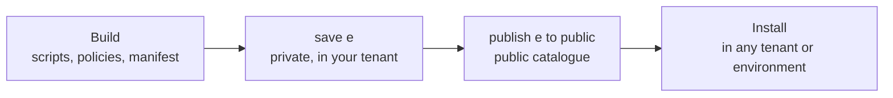

# Saving, installing and publishing



---

## Saving

`save e` in a `create-extension.odsl` script, or the Build an extension playbook, saves the extension to your tenant. It appears in the portal straight away for the people in its feature policy.

Once an extension is saved:

- **Saving a page** (a view's script) changes what the view shows at once. There is no need to save the extension again.
- **Adding or changing views, or resources,** needs the extension saved again.

---

## Publishing to the public catalogue

To let other OpenDataDSL tenants install your extension, publish it:

```js
e = ${extension:"acme.positions"}
publish e to "public"
```

:::info
Publishing to the public catalogue needs a publisher code. Apply for one by logging a request in the [support portal](https://support.desk.opendatadsl.com/servicedesk/customer/portal/4).
:::

Publish again whenever you change the extension; each publish is a new version.

---

## Installing

Tenants install a public extension from the extension catalogue in the portal, or with a script:

```js
e = ${extension:public/"acme.positions"}
publish e to "private"
```

Installing copies the extension and its resources (the scripts, insight reports and policies it lists) into the tenant, and runs its `install` script if it has one. Installing a newer version upgrades it and runs its `upgrade` script.

To install into another environment of your own tenant, for example from development to production, select the environment first:

```js
use production
e = ${extension:public/"acme.positions"}
publish e to "private"
```

Or keep the `create-extension.odsl` script and the pages in source control, and run the script in each environment.

### Preview extensions

An extension that uses features from the next platform release sets `e.preview = true`. A preview extension can only be installed in the **preview** environment: installing it anywhere else, including production, fails with error 6402. Once the release reaches production, set `e.preview = false` and publish the extension again so it can be installed everywhere.

```js
use preview
e = ${extension:public/"acme.positions"}
publish e to "private"
```

---

## Uninstalling

```js
delete ${extension:"acme.positions"}
```

This runs the extension's `uninstall` script if it has one.

:::warning
Deleting an extension you created yourself, rather than one you installed from the catalogue, removes it completely. Keep its `create-extension.odsl` script so you can create it again.
:::

---

## Checklist before publishing

- Every page, partial and insight page is in `e.resources.script`
- Every insight id is in `e.resources.reportconfig`
- The feature policy and every data policy are in `e.resources.policy`
- `e.description`, `e.icon` and `e.documentation` say what the extension is for and where to read more
- The pages work for a user who only has the access your policies give
