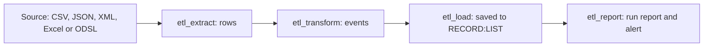

# How Data Loaders work

A data loader is extract, transform and load in three steps, each done by a standard action, with a fourth that records the run.

---

## The design and the deployed loader

You build the loader in the Data Loaders screen. Its design, including the sample, is kept by the extension. Nothing runs until you **deploy** it, which saves:

| What | Id | What it does |
|-|-|-|
| Workflow | `etl_<code>`, e.g. `etl_broker_gas_settlements` | Runs the standard actions in four phases: EXTRACT, TRANSFORM, LOAD and RECORD. You can open it in the Workflow Manager. |
| Process | `ETL_<CODE>`, e.g. `ETL_BROKER_GAS_SETTLEMENTS` | Runs the workflow with the loader's settings as its input, when you run it or on its schedule. |
| Run report | `ETL_<CODE>` | A report that each run adds itself to, one per day. |
| Custom action | `etl_extract_<code>` | Only for a custom ODSL source: your code, as an action. |

The process carries a copy of the loader's settings. When you change the loader, the screen shows it as **changed** until you deploy it again; runs use the deployed settings.

:::note
The workflow is made by the extension. If you change it in the Workflow Manager, deploying the loader again replaces it.
:::

---

## The workflow

| Phase | Step | Action | Exits |
|-|-|-|-|
| EXTRACT | `extract_rows` | `etl_extract` (or the custom action) reads the source | ok, failed |
| TRANSFORM | `make_events` | `etl_transform` makes events with the mapping | ok, empty (no events), failed |
| LOAD | `save_events` | `etl_load` saves the events, 500 at a time | ok, failed |
| RECORD | `record_run`, `record_empty`, `extract_failed`, `transform_failed`, `load_failed` | `etl_report` records the run and raises or closes the alert | ok |

The workflow ends **success** after a run that loaded events or found nothing to load, and **failed** when a step failed.

---

## What happens to each row

1. The row is read. Columns of JSON and XML records are paths, such as `settle.price`.
2. The **conditions** are checked. A row that does not pass them all is left out (counted as left out, not a problem).
3. Each field gets its value: from a column, a fixed value, a template or the run date. The value map is applied, empty values are recognised, and the value is converted to its data type.
4. A row whose value cannot be converted, or whose required field is empty, is not loaded. It counts as a problem, and the first 20 problems are kept with the run, for example `Row 7: settle is not a number (30,9x1)`.
5. The event is made: event time (the run date when no column is mapped), start and end, the event type, the time zone, the event id and the `_dsid`.

---

## Run results

| Result | What it means |
|-|-|
| **success** | Events were made and saved. Rows may have been left out or have had problems. |
| **empty** | The source was read but no events were made: no rows, or every row left out. |
| **failed** | The source could not be read, every row had a problem, a row had a problem and the loader fails on problems, or the events could not be saved. The run report says in which step. |
