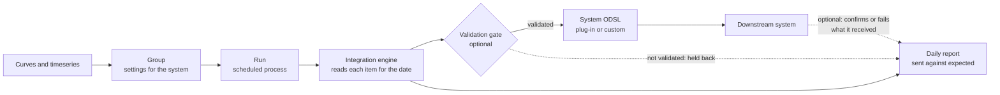

# How integrations work

An integration has four parts: the **system** the data goes to, the **groups** of curves and timeseries that go there, the **codes and settings** on each item, and the **run** that sends them. This page explains each one and what happens to every item in a run.

Two parts are optional. With the [validation gate](/docs/extensions/integration/validation-gate) on, only data that has passed validation is sent, and the rest is held back with the reason in the report. With [round-trip confirmations](/docs/extensions/integration/confirmations) on, the system reports back which items it loaded, and the daily report shows them as confirmed or failed.

---

## Systems

A system is where the data goes. Every system says what it needs: the codes it knows data by, the settings each group needs, the settings each item can have, the secrets it connects with, and the ODSL that sends the data. There are two kinds.

| Kind | Where it comes from | Who changes it |
|-|-|-|
| **Plug-in** | An extension made for the system, such as the Molecule plug-in. You install it on the Integrations screen or the Extensions screen; installing a plug-in installs the Integration extension too when it is missing. | Its publisher. On the screen you see what it needs on the **Plug-in** tab. |
| **Custom system** | Set up on the Integrations screen by your company, for a system that has no plug-in. | You, on its **System setup** tab, or with Fusion AI. |

The Integrations screen opens on its home page, which lists your systems with their groups, schedules, latest run and secrets. Choose one to work on it. While you work on a system, the **System** box at the top switches to another one, and **All systems** goes back to the home page. Custom systems are marked **custom**.

---

## Groups

The curves and timeseries to send are kept in an ordinary group of data (see the **Groups** screen). Groups of other services, such as master data objects, cannot be attached. When you attach a group to a system, the group gets the system's settings, such as which Molecule environment to use. A group sends to one system; to send the same curve to two systems, put it in two groups.

Every group also has these settings, whatever the system:

| Setting | Default | What it does |
|-|-|-|
| **Report key** | The system's code, such as `MOLECULE` | The run is merged into the report `INTEGRATION_<key>` for the date. Groups with the same key share one daily report. |
| **Ondate offset (business days)** | `0` | The date sent, counted from the day the run starts. `-1` sends the previous business day, for a run early in the morning. |
| **Calendar for the offset** | `BUSINESS` | The calendar the offset is counted on. |
| **Curves** | **The curve for the ondate** | Or **The curve for the ondate, or the latest one before it**, which sends the last curve there is when today's is missing. |
| **Validation gate** | **All data** | Or **Only validated data**: an item is only sent when its data has passed validation. Each item can follow the group or not, on the **Items** tab. See [The validation gate](/docs/extensions/integration/validation-gate). |

### Removing a group from a system

To stop sending a group, select **Remove** on its row on the **Groups** tab, or **Remove from** the system on its **Settings** tab (also in the **Integration** app on the Groups screen). A dialog says what is removed and what is kept before anything changes.

| What | When you remove a group |
|-|-|
| The group's settings for the system | Removed, including any secrets of its own it named. |
| Its schedule, the process `INTEGRATION_<GROUP>` | Deleted. A run already under way finishes. |
| The group and its curves and timeseries | Kept. You can attach the group to the same or another system again. |
| The reports already stored | Kept, with this group's rows. |
| The system's codes and data properties on its items | Kept, unless you tick **Also remove the codes and data properties**. Items another group of the same system sends, and public data, are always left alone. |
| The group's own secret records | Kept, unless you tick **Also delete the group's own secrets**. Only offered for records nothing else reads. |
| The system's secrets | Kept. |

---

## Identities and data properties

**Identities** are the codes the downstream system knows each curve or timeseries by. Molecule calls the TTF curve `M.TTF.F`; the lakehouse calls it `ttf_mid`. They are kept on the data item itself, one per system, so the same curve can carry its Molecule code and its lakehouse key at once. A system can mark an identity as required: an item without it is not sent.

**Data properties** are settings kept on each curve or timeseries, such as the timezone of its quarter hours. They also hold the values the daily report counts by, such as `location` (`NL`, `GB`, `DE`) and `category` (`GAS`, `POWER`, `SOLAR`).

You set both on a group's **Items** tab, for every item in the group at once.

---

## Secrets

**Secrets** are what a system needs to connect, such as a user and a password or an API key. Each secret of a system is kept in a secret record on the platform, named on the system: Molecule's user is kept in `molecule_user`. You set a secret's value on the system's **Plug-in** or **System setup** tab. The screen never shows a value back: it only shows whether it is set. Only the runs read them.

The secret store keeps the values in your company's own Azure Key Vault when it has one (see [Keeping your secrets in your own Azure Key Vault](/docs/it/key-vault)), otherwise in OpenDataDSL's.

A group uses the system's secrets unless it names its own on its **Settings** tab, for example a second Molecule account for one group. A system can mark a secret as required: a run stops before sending anything when a required secret is not set.

---

## What happens in a run

Each group runs as a process on the platform, on the schedule you give it (or when you select **Run now**). A run:

1. Reads the group and checks it is set up for this system.
2. Works out the date to send: the run date moved by the ondate offset, or the date you chose for **Run now**.
3. Reads the system's secrets, and stops if a required one is not set. Then it lets the system get ready, for example by signing in.
4. Reads each item in the group: a curve for the date, or the whole timeseries, with its identities and data properties.
5. With the validation gate on for an item, checks that its data has passed validation, and holds it back when it has not.
6. Hands each item that has data to the system's ODSL, which turns it into the system's format and sends it.
7. Lets the system finish, for example by sending one message for the whole group.
8. Merges the result of every item into the system's daily report for the date, replacing this group's earlier results for that date and keeping the other groups'.

Every item ends the run in one of these states:

| State | What it means |
|-|-|
| **complete** | Sent to the system. |
| **skipped** | Left out on purpose by the system, for example in a dry run. |
| **missing** | There is no data to send: no curve for the date. |
| **failed** | Not sent: the item could not be read, is not a curve or timeseries, has no required code, or the system refused it. The message says why. |
| **held back** | Not sent by the [validation gate](/docs/extensions/integration/validation-gate): its data has not passed validation. The message says why. In the report's counts and alerts it is a failure. |

The run itself ends **failed** when any item failed or had no data, so it shows in the process runs and can raise an alert. Its message lists each problem, for example `Molecule: 3 of 5 items sent for 2026-11-03; NGE.POWER.NL:BASE: No curve for 2026-11-03; NGE.POWER.GB:BASE: No molecule identity set`.

:::note
A run sends what it has. One late curve does not hold back the others: the four curves that are there are sent, and the late one shows as missing. Run the group again for the same date when the curve arrives.
:::

---

## Next

[Getting started with a plug-in](/docs/extensions/integration/getting-started) sets up Northgate's Molecule integration step by step.
