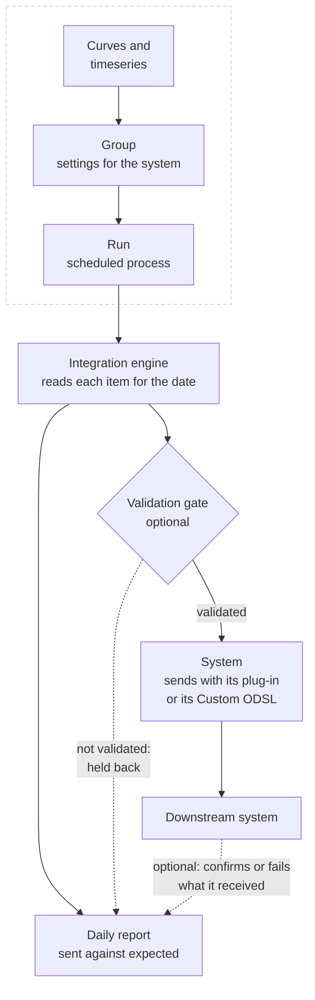

# How integrations work

An integration has four parts: the **system** the data goes to, the **groups** of curves and timeseries that go there, the **codes and settings** on each item, and the **run** that sends them. This page explains each one and what happens to every item in a run.

Two parts are optional. With the [validation gate](/docs/extensions/integration/validation-gate) on, only data that has passed validation is sent, and the rest is held back with the reason in the report. With [round-trip confirmations](/docs/extensions/integration/confirmations) on, the system reports back which items it loaded, and the daily report shows them as confirmed or failed.

---

## Systems

A system is one destination for the data: a name, a code, the secrets it connects with, and the codes its data is sent with. It sends with a **plug-in**, or with ODSL you write.

| Sends with | What it is | Who changes how it sends |
|-|-|-|
| **A plug-in** | An extension made for a kind of destination, such as Molecule, Azure Blob Storage or a webhook. Install it on the Integrations screen or the Extensions screen; installing a plug-in installs the Integration extension too when it is missing. The plug-in says what its systems need: the codes they know data by, the settings each group needs, the settings each item can have, the secrets they connect with, and the ODSL that sends the data. | Its publisher. Each system on it has its own name, code, secrets, groups and daily report. |
| **Custom ODSL** | For a destination that has no plug-in. You choose the codes, settings and secrets and write the ODSL, or Fusion AI writes it with you. See [Custom systems](/docs/extensions/integration/custom-systems). | You, on its **System setup** tab. |

Many systems can send with one plug-in. Northgate writes its curves to two Azure Blob Storage containers, one for the trading desk and one for finance: two systems on the Azure Blob Storage plug-in, each with its own storage account key, groups and daily report. Ten destinations of the same kind need the plug-in installed once, and ten systems.

To add a system, select **New system**: choose the plug-in it **Sends with** (or **Custom ODSL**), give it a name, a code and a description, and choose its codes. The dialog also lists the plug-ins you can install; installing one comes back to the dialog with it chosen.

Each system is kept as a private object `INTEGRATION.<CODE>` of type `INTEGRATION_SYSTEM`, such as `INTEGRATION.FINANCE_BLOB`. Its code names its daily report `INTEGRATION_<CODE>` and its secret records, such as `finance_blob_accountkey`, and cannot be changed later.

The Integrations screen opens on its home page, which lists your systems with their plug-in, groups, schedules, latest run and secrets. Choose one to work on it. While you work on a system, the **System** box at the top switches to another one, and **All systems** goes back to the home page. The **System setup** tab has the system's name, description and codes, with **Copy to a new system** and **Delete the system**, and, for a system on a plug-in, what the plug-in needs.

### The codes a system sends with

Each system chooses the identities (see below) its items are sent with:

| Codes | The identities | Use it when |
|-|-|-|
| **Shared** | The plug-in's own, such as `blob_code`, shared by every system on the plug-in that chooses them. | The systems are one downstream system split in two, such as Molecule power and Molecule gas: a curve has one Molecule code. |
| **Own codes** | Named after the system's code: its code, `_` and the plug-in's identity, such as `finance_blob_blob_code`. | The destinations know the same curve by different codes. |
| **The same codes as** another system | That system's identities. | A new system for a destination that already has its codes, such as a test copy of a production system. |

A new system has its own codes when the plug-in already has a system, and shared codes otherwise. Change them on the **System setup** tab. The plug-in's ODSL reads the identities by the plug-in's names whichever you choose, so it works the same for every system. Choosing other codes does not copy the codes already given: give the items their codes on the **Items** tab.

### Systems set up before 2026-11-07

Before systems were kept as objects, each plug-in was one system, and a custom system was an extension `custom.<code>`. Those keep sending as they did, and the home page marks them **not upgraded** with an **Upgrade to systems** card. The upgrade lists what it does before anything changes: it makes an object for each system with the same name, code, report key, secrets and shared codes, points its groups, its report, its confirmation and cutoff processes at it, and removes the extension record of a custom system. A custom system that used a plug-in's ODSL becomes a system on that plug-in.

---

## Groups

The curves, timeseries and options to send are kept in an ordinary group of data (see the **Groups** screen). Groups of other services, such as master data objects, cannot be attached. When you attach a group to a system, the group gets the system's settings, such as which Molecule environment to use. A group sends to one system; to send the same curve to two systems, put it in two groups.

Every group also has these settings, whatever the system:

| Setting | Default | What it does |
|-|-|-|
| **Report key** | The system's code, such as `MOLECULE` | The run is merged into the report `INTEGRATION_<key>` for the date. Groups with the same key share one daily report. |
| **Ondate offset (business days)** | `0` | The date sent, counted from the day the run starts. `-1` sends the previous business day, for a run early in the morning. |
| **Calendar for the offset** | `BUSINESS` | The calendar the offset is counted on. |
| **Curves** | **The curve for the ondate** | Or **The curve for the ondate, or the latest one before it**, which sends the last curve there is when today's is missing. |
| **Validation gate** | **All data** | Or **Only validated data**: an item is only sent when its data has passed validation. Each item can follow the group or not, on the **Items** tab. See [The validation gate](/docs/extensions/integration/validation-gate). |

### Removing a group from a system

To stop sending a group, select **Remove** on its row on the **Groups** tab, or **Remove from** the system on its **Settings** tab (also in the **Integration** app on the Groups screen). A dialog says what is removed and what is kept before anything changes.

| What | When you remove a group |
|-|-|
| The group's settings for the system | Removed, including any secrets of its own it named. |
| Its schedule, the process `INTEGRATION_<GROUP>` | Deleted. A run already under way finishes. |
| The group and its curves and timeseries | Kept. You can attach the group to the same or another system again. |
| The reports already stored | Kept, with this group's rows. |
| The system's codes and data properties on its items | Kept, unless you tick **Also remove the codes and data properties**. Items another group of the same system sends, and public data, are always left alone. |
| The group's own secret records | Kept, unless you tick **Also delete the group's own secrets**. Only offered for records nothing else reads. |
| The system's secrets | Kept. |

---

## Identities and data properties

**Identities** are the codes the downstream system knows each curve or timeseries by. Molecule calls the TTF curve `M.TTF.F`; the lakehouse calls it `ttf_mid`. They are kept on the data item itself, one per system (or per set of shared codes), so the same curve can carry its Molecule code and its lakehouse key at once. A system can mark an identity as required: an item without it is not sent.

**Data properties** are settings kept on each curve or timeseries, such as the timezone of its quarter hours. They also hold the values the daily report counts by, such as `location` (`NL`, `GB`, `DE`) and `category` (`GAS`, `POWER`, `SOLAR`).

You set both on a group's **Items** tab, for every item in the group at once.

---

## Secrets

**Secrets** are what a system needs to connect, such as a user and a password or an API key. Each secret of a system is kept in a secret record on the platform, named on the system: Molecule's user is kept in `molecule_user`. You set a secret's value on the system's **System setup** tab. Two systems on one plug-in can read the same records, for the same account, or records of their own, such as `finance_blob_accountkey`. The screen never shows a value back: it only shows whether it is set. Only the runs read them.

The secret store keeps the values in your company's own Azure Key Vault when it has one (see [Keeping your secrets in your own Azure Key Vault](/docs/it/key-vault)), otherwise in OpenDataDSL's.

A group uses the system's secrets unless it names its own on its **Settings** tab, for example a second Molecule account for one group. A system can mark a secret as required: a run stops before sending anything when a required secret is not set.

---

## What happens in a run

Each group runs as a process on the platform, on the schedule you give it (or when you select **Run now**). A run:

1. Reads the group and its system, and checks that the group is set up for the system and that the system sends with this plug-in or ODSL.
2. Works out the date to send: the run date moved by the ondate offset, or the date you chose for **Run now**.
3. Reads the system's secrets, and stops if a required one is not set. Then it lets the system get ready, for example by signing in.
4. Reads each item in the group: a curve for the date, or the whole timeseries, with its identities and data properties.
5. With the validation gate on for an item, checks that its data has passed validation, and holds it back when it has not.
6. Hands each item that has data to the system's ODSL, which turns it into the system's format and sends it.
7. Lets the system finish, for example by sending one message for the whole group.
8. Merges the result of every item into the system's daily report for the date, replacing this group's earlier results for that date and keeping the other groups'.

Every item ends the run in one of these states:

| State | What it means |
|-|-|
| **complete** | Sent to the system. |
| **skipped** | Left out on purpose by the system, for example in a dry run. |
| **missing** | There is no data to send: no curve for the date. |
| **failed** | Not sent: the item could not be read, is not a curve, timeseries or options, is a kind of data the system does not take, has no required code, or the system refused it. The message says why. |
| **held back** | Not sent by the [validation gate](/docs/extensions/integration/validation-gate): its data has not passed validation. The message says why. In the report's counts and alerts it is a failure. |

The run itself ends **failed** when any item failed or had no data, so it shows in the process runs and can raise an alert. Its message lists each problem, for example `Molecule: 3 of 5 items sent for 2026-11-03; NGE.POWER.NL:BASE: No curve for 2026-11-03; NGE.POWER.GB:BASE: No molecule identity set`.

:::note
A run sends what it has. One late curve does not hold back the others: the four curves that are there are sent, and the late one shows as missing. Run the group again for the same date when the curve arrives.
:::

---

## History exports

A history export sends a group for every date of a range, to load history into a system or to send a period again after a fix. On the group's **Schedule and runs** tab, under **History export**:

1. Give the **First ondate** and the **Last ondate**. Both are sent.
2. Check the **Calendar**: the dates sent are its business days. It starts as the group's own calendar; `DAILY` sends every day.
3. Tick **Raise the group's alerts for these dates** only if you want them. A history export raises no alerts unless you do, since it sends earlier dates.
4. Select **Run the history export**, check the dates, and select **Run it**.

The group's process runs once and sends the dates one after the other, oldest first. Each date is a run like the one above, for that date: the curves for the date are read, sent, and merged into that day's report, replacing what it said for the group. A date with problems does not stop the others. The run's message counts the dates sent completely and names the ones with problems, such as `History export of NGE_MOLECULE_CURVES from 2026-10-01 to 2026-10-31: 21 of 22 dates sent completely; problems on 2026-10-12 (...)`. Its log shows each date's run.

A history export sends at most 400 dates. For longer periods, run several. It takes as long as the runs of all its dates together, so a long one on a busy system is best started outside the system's working hours.

When a dataset corrects data that was already sent, a group with [corrections](/docs/extensions/integration/corrections) on sends the corrected items again for the dates the corrections change, by itself, without a history export.

---

## Next

[Getting started with a plug-in](/docs/extensions/integration/getting-started) sets up Northgate's Molecule integration step by step.
