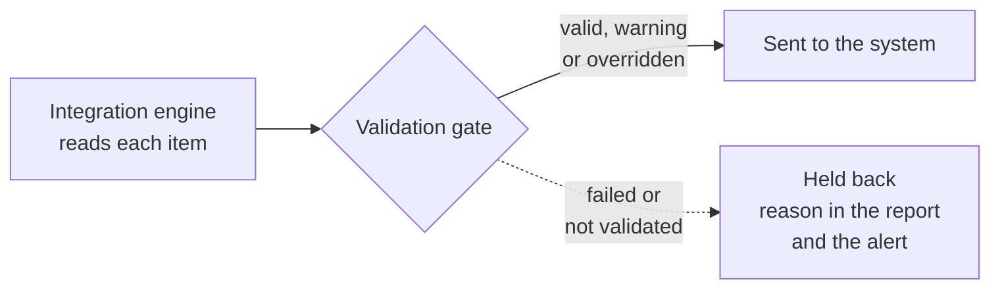

# The validation gate

---

## What it does

A downstream system trusts what it is sent. When a curve has a bad price in it, the ETRM revalues the books on that price before anyone notices. The **validation gate** stops that: a group with the gate on only sends data that has passed its checks in the [Validation extension](/docs/extensions/validation/overview). Anything else is **held back**, and the daily report and the group's alert say why.

Data has passed validation when its validation record for the date the run sends is:

| Status | Sent? |
|-|-|
| **valid** | Yes |
| **warning** | Yes. The checks warned but did not fail. |
| **overridden** | Yes. Someone passed a failure with a reason in the Validation extension. |
| **failed**, **severe** or **error** | No: held back. |
| **skipped** (every check was skipped), no record for the date, or no validation set up | No: held back. |

For a curve the gate looks at the record of the curve the run sends: the curve for the ondate, or the latest one before it when the group's **Curves** setting says so. For a timeseries it looks at the records of its observations on the ondate: every one must pass.

---

## Setting it up

The gate is set for each group, and each item can follow the group or not.

1. On the Integrations screen, open the group on the **Groups** tab.
2. On its **Settings** tab, under **Validation gate**, choose **Only validated data** in **Send**.
3. Select **Save settings**.

Then, on the group's **Items** tab, the **Validation** column says what each item does:

| Choice | What the item does |
|-|-|
| **Group setting** | Follows the group. The choice shows the group's setting: **validated** or **not checked**. |
| **Must be validated** | Always goes through the gate, even when the group sends all data. |
| **Not validated** | Never goes through the gate, even when the group only sends validated data. For example a timeseries you do not validate. |

Change the choices you need and select **Save changes**.

The data itself needs validation set up in the Validation extension, ideally running when the data is updated, so that its checks have run before the group's scheduled run.

---

## When an item is held back

A held back item is not sent. In the day's report:

- the card **Held back by validation** counts it;
- on the **Items** tab its state is **held back**, its status `held back by validation`, and its message says why, such as `Not sent because it failed validation for 2026-11-03 (failed): Change of 12% is above the 5% limit`;
- the **Validation** column shows the status the gate found;
- its matrix cell counts it as a failure, and the status filter **Held back by validation** finds it.

The run's message lists each held back item with its reason, and the run ends failed, like a run with any other failure.

| Message | What to do |
|-|-|
| `Not sent because it failed validation for <date> (<status>): <message>` | Fix the data, or override the failure in the Validation extension with a reason, then run the group again with **Run now**. |
| `Not sent because it has not been validated for <date>` | The checks have not run for that date yet. Run the item's validation, then run the group again. |
| `Not sent because every check was skipped for <date>` | No check applied to the data. Check the item's validation configuration. |
| `Not sent because it has no validation set up` | Set up validation for the item, or choose **Not validated** for it on the group's **Items** tab. |
| `Not sent because its validation is switched off` | Its validation configuration is disabled. Enable it, or choose **Not validated** for the item. |

---

## Alerts

With [group alerts](/docs/extensions/integration/alerts-and-cutoff#group-alerts) on, a run that holds items back raises the group's alert for the date, with each held back item and its reason in the message. Its issue is `validation`, as validation is the root cause of the data not being sent. When the alert is already open from an earlier run with another issue, such as `export`, it keeps that issue and the occurrence is added to it.

The [cutoff check](/docs/extensions/integration/alerts-and-cutoff#the-cutoff) lists held back items among its problems, and its alert also has the issue `validation` when any were held back, unless it was already open with an issue.

An item that is not available every day and has no data for the date is not held back: it has nothing to send.

---

## Next

- [Corrections](/docs/extensions/integration/corrections): send data again when a dataset corrects it.
- [Alerts and the cutoff](/docs/extensions/integration/alerts-and-cutoff): be told when something is not sent.
- [Integration reference](/docs/extensions/integration/reference): where the settings are kept, and troubleshooting.
