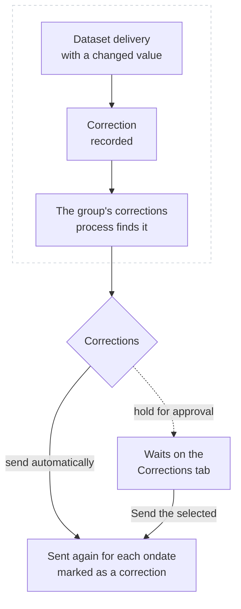

# Corrections

---

## What it does

A vendor corrects data: a settlement price is republished, a capture price for last month is revised. The platform records every value of a dataset that changes after it was delivered as a **correction**. With corrections on, a group sends the items that value feeds again, for every ondate the value is in, and marks what it sends as a correction so the downstream system can treat it as one.

Which ondates are sent again depends on the data:

| Corrected value | Ondates sent again |
|-|-|
| A contract of a curve | The curve's ondate. |
| A daily value of a timeseries | That day. |
| A monthly value of a timeseries | Every ondate of that month, in the group's calendar (BUSINESS by default, DAILY for every day). |

So when the capture price for October changes, a group that sends it to Molecule as the day's quarter hours sends all of October's days again, each as that day's quarter hours with the corrected value.

Only ondates within the **look back** are sent (62 days by default, enough for the previous month), and never ondates after today. Several corrections of the same item and ondate, such as many contracts of one curve, are sent together once.

---

## Setting it up

1. On the Integrations screen, open the group on the **Groups** tab.
2. On its **Settings** tab, under **Corrections**, choose how they are sent:
   - **Send corrections automatically**: each correction is sent as soon as it is found.
   - **Hold corrections for approval**: each waits on the **Corrections** tab until someone sends or ignores it.
3. Set **Look back (days)**, **Send again** (every ondate the value is in, or only the first of them) and how often to **Check for corrections**.
4. Select **Save settings**.

Saving creates the group's corrections process, `INTEGRATION_CORRECT_<GROUP>`, which runs the system's script on the schedule you chose. Its first run notes where the corrections are up to: corrections recorded before corrections were switched on are not sent. To send those, use a [history export](/docs/extensions/integration/how-it-works#history-exports) for the dates.

Choosing **Off** switches the process off.

### Where an item's corrections come from

Corrections are recorded for datasets. The process works out each item's dataset once a day:

- a curve or timeseries built from a dataset's events has its dataset in its `dsid` property;
- for any other item, such as a smart timeseries calculated from dataset data, set the data property `correction_dsid` to the dataset it comes from, such as `NGE.CAPTURE.DE`.

The **Corrections** tab lists the datasets watched and names the items it found no dataset for.

---

## The Corrections tab

The group's **Corrections** tab shows the corrections of the day, newest first, with what changed, when it was received and what happened to it.

| Status | What it means |
|-|-|
| **waiting for approval** | The group holds corrections for approval. Select it and **Send the selected**, or **Ignore the selected**. |
| **to send**, **approved, to send** | It is sent by the process's next run. |
| **sent** | Sent again, marked as a correction. |
| **failed** | It could not be sent: the message says why. Select it and **Send the selected** to try again. |
| **skipped** | The system skipped it. |
| **ignored** | Someone chose not to send it. |
| **too old** | It waited past the look back without being sent. |

**Check now** runs the process at once instead of waiting for its schedule. Corrections still open at the end of a day (waiting, to send or failed) are carried into the next day's list; the rest stay in the log of their day, the report `INTEGRATION_CORRECTIONS_<GROUP>` on the platform's **Reports** screen.

---

## What the system receives

A correction is sent the way the group sends anything, for the ondate it corrects, with the group's transformation, the [validation gate](/docs/extensions/integration/validation-gate) and the dry run setting. The plug-ins mark it as a correction:

| Plug-in | How a correction is marked |
|-|-|
| Molecule | With the group's **Mark level of corrections** as the `mark_level`, when it is set. See [Mark levels](/docs/extensions/integration/plugins/molecule#mark-levels). |
| Queue, webhook, Event Grid, blob, data lake and files | `"correction": true` in the message, with `note` saying what changed; `{correction}` in a file name pattern becomes `_correction`. See [What the generic plug-ins send](/docs/extensions/integration/plugins/generic-content). |
| A custom system | Its ODSL reads `ctx.correction` (true for a correction) and `item.correction` (what changed). |

In the day's report the item shows **corrected**, with what changed under its message, and the status filter **Sent again as a correction** finds it. The report's other items stay as they were.

---

## Alerts

With [group alerts](/docs/extensions/integration/alerts-and-cutoff#group-alerts) on, a corrections run with corrections that could not be sent raises the alert `integration/<group>/corrections`, with issue `export`. A later run that sends corrections closes it.

---

## Next

- [Integration reference](/docs/extensions/integration/reference): where the settings and logs are kept, and troubleshooting.
