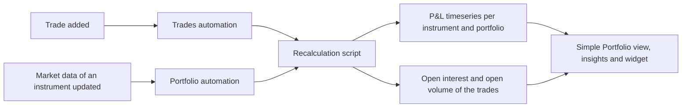

# What is Simple Portfolio?

**Simple Portfolio** keeps an up-to-date profit and loss (P&L) for groups of instruments you trade. You put the instruments in a **portfolio**, record your **trades** against them, and the extension works out:

- the daily P&L of each instrument, marked to its market data
- the daily P&L of each portfolio, the sum of its instruments
- the **open interest** (running net position) after each trade
- the **open volume** of each trade: what is still open after later trades in the other direction closed it, oldest first

It is also an example extension: everything it does is built from standard platform features (groups, events, timeseries, automations, insights), so it is a good place to see how an extension fits together.

---

## The main ideas

| Term | What it is |
|-|-|
| Portfolio | A group (type `Portfolio`, category `Simple Portfolio`) of instruments |
| Instrument | A timeseries of market prices, such as a settlement price or a curve tenor like `ICE.IFEU.B:SETTLE:M01` |
| Trade | An event in the event list `SIMPLE_PORTFOLIO:TRADES`: a reference, the instrument, the price and the volume (negative for a sale) |
| P&L | A business-day timeseries: for each trade, (market price - trade price) x volume from the trade date, summed |
| Open interest | The running net volume of an instrument after each trade |
| Open volume | What is left of a trade after later opposite trades closed it, oldest first |

---

## What it adds

| Component | Where | What it does |
|-|-|-|
| **Simple Portfolio** view | Portal menu, **Extensions** | Portfolios, instruments, trades, open positions and P&L charts. See [Using Simple Portfolio](/docs/extensions/simple-portfolio/using) |
| **Trade Report** insight | Insights | Trades in a date range, by instrument, by day and the largest trades. See [Insights](/docs/extensions/simple-portfolio/insights) |
| **Open Trade Positions** insight | Insights | Open positions, their cost, by instrument and by age |
| **Simple Portfolio Chart Widget** | Dashboards | A portfolio's P&L chart for a dashboard |
| Recalculation automations | Automations | Recalculate when trades are added or market data changes. See [How it works](/docs/extensions/simple-portfolio/how-it-works) |

---

## Getting started

1. Install the **Simple Portfolio** extension in your environment. The install creates the `SIMPLE_PORTFOLIO` master data object and the automation that recalculates when trades are added.
2. Open **Extensions > Simple Portfolio** and click **New portfolio**. Give it a name and, optionally, its instruments.
3. Click **Add trade** to record a trade against one of the portfolio's instruments.
4. After a minute, reload: the trade's P&L, open interest and open volume have been calculated, and the portfolio's P&L chart shows the result.

:::tip
The P&L of an instrument can only be calculated where it has market data. If a chart stays empty, check that the instrument id is right and that its timeseries has values from the trade date onwards.
:::
