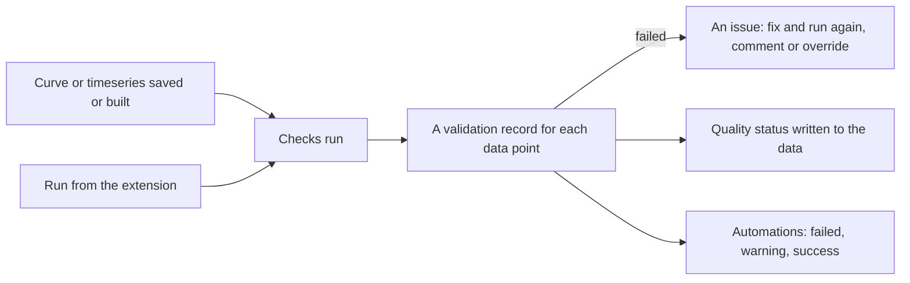

# What is Validation?

**Validation** checks your curves and timeseries with checks written in ODSL, and keeps a record of every result. For example:

- Is today's settlement price missing, zero or negative?
- Did any tenor of the forward curve move by more than 20% overnight?
- Is a value an outlier compared with the last 30 observations?
- Has the curve got gaps between its delivery periods, or has it lost tenors since yesterday?
- Has a price not changed for five days in a row?

Each curve or timeseries you validate has a **validation configuration** holding its checks. Every data point that is checked gets a **validation record**: the result of each check, the status that applies, and a timeline of everything that happened to it. When a check fails, you can fix the data and run it again, comment on it, or **override** it so the data can be used.

---

## What gets checked

| Data | A record for each | Record id |
|-|-|-|
| Timeseries | observation | `DATA_ID:TIME`, for example `AHDB.HAY:PRICE:2026-10-01` |
| Curve | ondate | `DATA_ID:ONDATE`, for example `ICE.IFEU.B:SETTLE:2026-10-12` |

A curve has two kinds of checks: **tenor checks** run on every contract (is the M03 value missing? did Q1 move by more than 20%?) and **curve checks** run once on the whole curve (are there gaps? are the expected tenors there?). The record of a curve shows the result of every tenor, which tenors failed or warned, and the result of each check. **Any failing tenor fails the whole curve.**

---

## When checks run

| When | What is checked |
|-|-|
| A curve or timeseries is saved | The ondate saved, or the observations in the update |
| A smart or event curve is built because its inputs changed (or by the queue or the cut-off) | The ondate built |
| You run the checks in the extension, or through the REST API | The latest data point, a date or a range |

Checks never run when data is only read, and not during history loads. They only run automatically for private data: public data is checked when you run its checks. You can switch automatic runs off for a configuration and only run it by hand.

---

## Statuses

The status of a record is the worst result of its checks.

| Status | Meaning |
|-|-|
| **Valid** | Every check passed |
| **Warning** | A check found something worth a look; the data can be used |
| **Failed** | A check failed |
| **Severe** | A check failed badly |
| **Error** | A check could not run, for example because of an unknown function. It counts as failing, because the data was not checked |
| **Skipped** | There was nothing to check, for example no previous value to compare with |
| **Overridden** | The checks failed and someone let the data pass, with a reason |

Valid, warning, skipped and overridden records **pass**. Failed, severe and error records are **open issues**.

When a record is checked, the quality status of the data is updated too (for a curve, the worst status of all the records of its ondate), so other screens and reports can see whether the data passed.

---

## Where to find it

- **Information > Validation**: the dashboard, issues, records, configurations, check functions, bulk changes and reports.
- The **Validation** tab on the **Data** screen: the checks and records of the selected curve or timeseries.

---

## In this section

| Page | What it covers |
|-|-|
| [Getting started](/docs/extensions/validation/getting-started) | Set up, test and run the checks of a timeseries, and look at the results |
| [Checks and settings](/docs/extensions/validation/checks) | Validation configurations: checks, scopes, severity, settings |
| [Check functions](/docs/extensions/validation/functions) | The functions in the validation library |
| [Writing your own checks](/docs/extensions/validation/writing-checks) | Private check functions in ODSL |
| [Dashboard, issues and overrides](/docs/extensions/validation/dashboard) | The dashboard, issues, records, the timeline, overrides and reports |
| [Bulk changes](/docs/extensions/validation/bulk) | Add, replace or remove checks on many curves or timeseries at once |
| [Reference](/docs/extensions/validation/reference) | The records, automations and the REST API |

:::note
Dataset quality checks and curve quality groups work as before. Validation is a separate registry for curves and timeseries, and the functions of a curve quality group script can be used as validation checks.
:::
